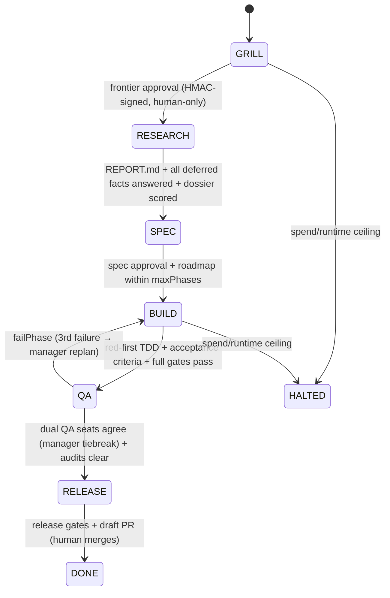
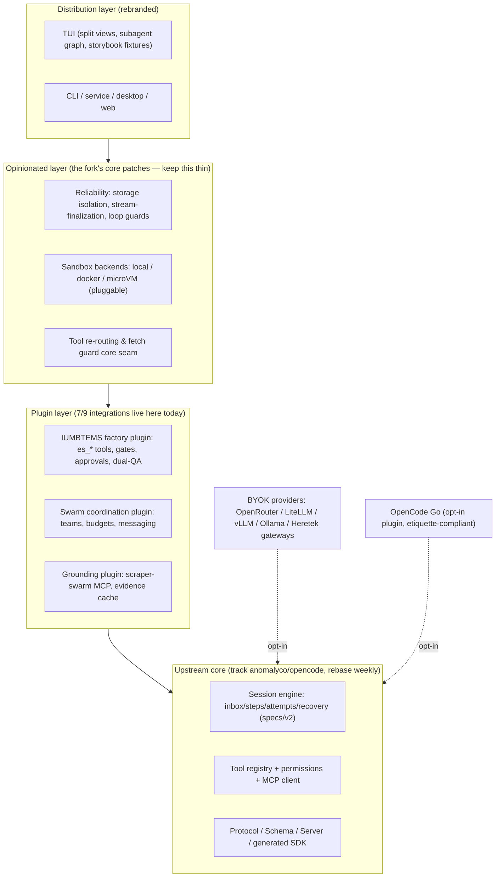

# OpenCode Fork Fact-Finding — Master Report ("Better Mouse Trap")

**Date:** 2026-10-07 · **Scope:** feasibility, legal perimeter, community demand, competitive landscape, sister-tech synergy, and architectural blueprint for an opinionated OpenCode fork ("OpenCode Prime" / "Oh-My-OpenCode", working titles).

**Evidence standard:** every claim is cited to a primary source (file path + line, URL, commit/PR/issue number, registry/API observation). Claims that could not be verified are labeled **NOT FOUND** or **UNVERIFIED** with the search trail. The mission brief was treated as a set of claims to test, not as evidence. Deep detail lives in the four track files:

| Track | Findings file |
|---|---|
| 1 — Legal, licensing, ToS | [`research/track-1-legal-licensing.md`](research/track-1-legal-licensing.md) |
| 2 — Community friction | [`research/track-2-community-friction.md`](research/track-2-community-friction.md) |
| 3 — Harness landscape | [`research/track-3-harness-landscape.md`](research/track-3-harness-landscape.md) |
| 4 — Sister projects | [`research/track-4-sister-projects.md`](research/track-4-sister-projects.md) |

---

## 0. Executive verdict

**GO — with two non-negotiable constraints and one corrected premise.**

1. **You must fully rebrand.** "OPENCODE" is a registered word mark (USPTO serial 99379413, Anomaly Innovations Inc.). All three working titles — "OpenCode Prime", "Oh-My-OpenCode", "Heretek OpenCode" — embed the registered mark for identical goods (Cl. 9 software, Cl. 42 SaaS) and are **HIGH** naming risk. MIT licensing of the code is unrestricted; trademark law is the binding constraint (§2.3).
2. **You must decouple from `opencode.ai` defaults** for clean-room posture: strip `opencode`/`opencode-go` catalog entries and default endpoints, keep Go as a strictly opt-in, etiquette-compliant plugin (§2.5).
3. **Corrected premise:** the brief's "naive while-loops" characterization of the core engine is wrong. V2 is already a durable event-sourced engine: inbox admission → delivery → Step with Physical Attempts → write-ahead execution claims for recovery (`specs/v2/session.md:5-117`). The gap is not the engine; it is **phase-gated orchestration above the session layer, subagent coordination, and core reliability** (§6.3).

The market case is strong and evidence-backed: upstream's highest-demand, longest-ignored work — multi-provider failover (#7602, PR #26292 abandoned), agent teams (#12711/#12730, 8 months unmaintained), deep configurability (founder declined PR #5422), reliability fixes whose PRs were auto-closed (#37852 class) — is exactly this fork's product thesis (§3).

### 0.1 Five brief premises vs. verified reality

| Brief premise | Verified reality | Impact on plan |
|---|---|---|
| "Naive while-loops" need replacing with a DAG engine | V2 already has durable Step/Attempt semantics, retry policy, compaction budgeting, crash recovery (`specs/v2/session.md`) | Layer gating *above* sessions (plugin-level factory); do not rewrite the runner |
| `awesome-harness` = curated ecosystem; classics like Cline, AutoGen, E2B are in it | Autogenerated GitHub-topic index (`scripts/generate_list.py`); only **6 of 26** brief-named projects listed; flagships (OpenHands 90.2k★, aider 49.4k★) land in the fallback bucket | Steal mechanisms from the 33 deep-dived projects, not taxonomy positions; counts (46/74/39/18/2/49/95 = 323) are all correct |
| Naming "OpenCode Prime" / "Oh-My-OpenCode" is a branding question | Registered word mark "OPENCODE" exists (Reg. #8267298 per Trademarkia; serial 99379413 verified via Justia) | Full rebrand is a legal deliverable, Phase 0, before any public release |
| scraper-swarm does "distributed scraping, live intelligence, doc caching" | Multi-engine scraping cluster with scoped-key MCP gateway exists; "distributed scraping"/"live intelligence" **NOT FOUND** as terms; doc caching is IUMBTEMS's (`research/cache.ts`), not scraper-swarm's | Market the substance (scoped keys, SSRF fail-closed, rate limits, audit chain); drop the buzzwords |
| OpenCode Go terms create a legal minefield for swarms | Verified ToS (eff. 2026-08-15) + Go docs: single-member workspaces, "own internal use… not on behalf of any third party", monitored traffic, client etiquette that *permits* third-party clients | Go is usable by the fork as opt-in BYOK with intact etiquette; pooling/reselling is the bright line (§2.4) |

---

## 1. Evidence ledger (mission-brief claims)

### 1.1 Legal & product claims (Track 1)

| Claim | Verdict | Source |
|---|---|---|
| Core is MIT, "Copyright (c) 2025 opencode" | **VERIFIED** | `LICENSE:1-22` |
| MIT permits fork/modify/rebrand/sublicense/sell/close-source | **VERIFIED** | `LICENSE:5-8` (grant clause) |
| Only conditions: notice retention + AS-IS disclaimer | **VERIFIED** | `LICENSE:9-11`, `LICENSE:13-22` |
| Explicit patent grant | **NOT FOUND** — MIT has zero patent language; no CLA/DCO/patent policy in repo or upstream | grep `patent` → 0; `CONTRIBUTING.md`; issue search "CLA" → 0 results |
| "OpenCode Go" $10/mo, "Go Plus" $40/mo | **VERIFIED** | `services/www/src/docs/content/console/go.mdx:10-11` |
| Endpoint `https://opencode.ai/zen/go/v1` | **VERIFIED** | `console/go.mdx:391-420`; `packages/console/function/src/log-processor.ts:17-20`; live 200 (2026-10-07) |
| Models Grok 4.7, Kimi K3, GLM-5.3, Qwen 3.8, DeepSeek V4 | **VERIFIED** (Qwen3.8 Max/Flash; DeepSeek V4.1 Flash/V4 Pro/V4 Flash) | `console/go.mdx:36-65` |
| Go limited to single-member workspaces | **VERIFIED** | `console/go.mdx:33-34`; `console/members.mdx:20` |
| OpenCode ToS exists | **VERIFIED** — https://opencode.ai/legal/terms-of-service, eff. Aug 15 2026, ANOMALY INNOVATIONS, INC. | live read 2026-10-07; repo source `packages/console/app/src/routes/legal/terms-of-service/index.tsx` |
| Separate AUP / Cloud API agreement | **NOT FOUND** (grep + web search trail in Track 1 §3.2) | — |
| "OPENCODE" trademark | **VERIFIED application** (serial 99379413, Anomaly Innovations Inc., filed 2025-09-08, Cl. 9+42); **registration #8267298 UNVERIFIED** (Trademarkia aggregator only; USPTO TSDR needs API key) | justia.com/993/79/opencode-99379413.html; trademarkia.com/opencode-99379413 |
| Upstream is `anomalyco/opencode` (ex-`sst/opencode`) | **VERIFIED** | GitHub API 301 sst→anomalyco (repo id 975734319); README badge `README.md:14`; CONTRIBUTING.md:12 |
| Fork `Heretek-AI/opencode` status | **VERIFIED** — GitHub fork created 2026-10-07, parent anomalyco/opencode; `v2` head `119cb15d1d` = upstream `v2` head = local HEAD → **zero divergence**; GitHub default branch on both repos is `dev` (`v2` is this repo's working branch per AGENTS.md) | GitHub API; `git ls-remote`; `git remote -v` |

### 1.2 Community claims (Track 2)

| Claim | Verdict | Source |
|---|---|---|
| Upstream is a very-high-volume project | **VERIFIED** — 212,153★ / 28,254 forks; issue/PR numbers >53k | repo_view 2026-10-07 |
| Users demand multi-agent/swarm | **VERIFIED** — #12711 design + 3-PR working stack #12730-12732 (~11.7k lines) untouched by maintainers 8 months; #11012 subagent-enclosure closed `NOT_PLANNED` with 14 sibling issues | full reads of #12711, #12730, #11012 |
| Users demand multi-provider failover | **VERIFIED** — #7602 (top-reaction, open since 2026-01), #42513, #42502; PR #26292 abandoned after rebase churn | #26292 thread quotes |
| Container-sandbox demand (Docker/E2B/Firecracker) as a named feature cluster | **NOT FOUND** — issue search `sandbox container e2b firecracker isolation` → 0 results; demand exists as generic sandboxing (#2242, open 13+ months) and permission-escape bugs (#39931, #42979, #43336) | Track 2 §2(e) |
| Critical reliability bugs persist upstream | **VERIFIED** — SQLite corruption class (#14970, open since 2026-02), silent stream-drop recorded as success (#37852, 19 comments), compaction infinite loops (#48827), runaway token burn (#45442/#47253) | full reads |
| Fixes get auto-closed | **VERIFIED** — 5 tested fix PRs for #37852 class closed under `automated-pr-cleanup` (#39473, #43881, #42566, #44611, #40032) | PR search states 2026-10-07 |

### 1.3 Landscape claims (Track 3)

| Claim | Verdict | Source |
|---|---|---|
| awesome-harness: 323+ repos, 7 categories, counts 46/74/39/18/2/49/95 | **VERIFIED exactly** — 323 entries, all counts match, 323/323 URLs HTTP 200 | README rows + `data/harnesses.json` + badge |
| List is curated | **REFUTED** — autogenerated topic-intersection index with fallback bucket | `scripts/generate_list.py` `categorize_repositories()`; `config/topics.yaml` |
| Brief-named classics (Cline, Roo-Code, Mentat, GAIA, Terminal-Bench, HumanEval, Cybench, OSWorld, BrowserGym, AutoGen/AG2, CrewAI, ChatDev, Swarms, MetaGPT, LangGraph, E2B, Modal, Firecracker, Daytona, Devcontainers) are listed | **NOT LISTED (20 of 26)**; only Aider, SWE-agent, OpenHands, SWE-bench, AgentBench, WebArena are entries. Mentat (AbanteAI/mentat) and GAIA's GitHub repo **404** | Track 3 §3 set comparison + URL checks |

### 1.4 Sister-project claims (Track 4)

| Claim | Verdict | Source |
|---|---|---|
| IUMBTEMS = "AI Build Factory for OpenCode v2" | **VERIFIED** | `IUMBTEMS/README.md:3-5`; `packages/core/src/factory/machine.ts` |
| State machine `Grill → Research → Spec → Build ⇄ QA → Release` | **VERIFIED** — 8 states incl. DONE/HALTED, every transition stage+seat gated | `factory/state.ts:3`; `machine.ts:245-248` and transitions |
| Mechanical gating refuses out-of-order calls | **VERIFIED** | `machine.ts:245-248` → model-facing `ToolError` via `packages/opencode/src/tools.ts:66-70` |
| Human-only signed approvals agents cannot fake | **VERIFIED** | `approval/keystore.ts` (HMAC-SHA256, 0600), `approval/record.ts:1-6`, CLI `human.ts:33-66`, TUI `/es-approve` preview→redeem (`rpc.ts:183-227`) |
| Evidence verification before phase advancement | **VERIFIED mechanically** for red-first TDD, acceptance criteria, research quote/location witnesses; **ADVISORY** (prompt-level) for QA note citation format | `machine.ts:538-652`; `claims/witness.ts:1-51`; vs `machine.ts:663-677` |
| Dual-QA + independent auditors | **VERIFIED** — dual QA seats both required (`machine.ts:700-704`), thesis/antithesis auditors block advancement (`machine.ts:995-1003`), human-only dismissal | `agents/registry.ts:267-366` |
| scraper-swarm: `swarmd`, panel API, `@scraper-swarm/opencode-plugin` | **VERIFIED** | `apps/swarmd/`, `apps/panel-api/`, `packages/opencode-plugin/package.json` |
| scraper-swarm: "distributed scraping", "live intelligence", doc caching | **NOT FOUND** (zero grep hits); doc cache is IUMBTEMS's `research/cache.ts` | Track 4 §0 |
| scraper-swarm scoped keys, rate limits, fail-closed SSRF, hash-chained audit | **VERIFIED** | `apps/gateway/src/gateway/server.py:51,226-412,473,515-522` |

---

## 2. Track 1 — Legal, licensing & ToS boundaries

### 2.1 MIT permissions (what you may actually do)

| Permission | Clause | Notes |
|---|---|---|
| Fork, modify, rebrand code | `LICENSE:5-7` "use, copy, modify, merge" | No field-of-use limits |
| Publish, distribute, sublicense | `LICENSE:7-8` | Derivatives may carry different terms |
| Sell / commercialize / close-source | `LICENSE:8` "and/or sell copies" | Allowed; only duty is notice retention |
| **Obligation 1** | `LICENSE:9-11` | Keep "Copyright (c) 2025 opencode" + permission notice in every copy — a LICENSE/NOTICE file suffices; no trademark license implied |
| **Obligation 2** | `LICENSE:13-22` | Keep the AS-IS warranty/liability disclaimer |

**Patent posture:** MIT contains no patent grant and the project has no CLA/DCO/patent policy (verified: greps 0 hits, upstream issue search 0 results). Practically low risk for a dev tool; structurally unmitigated. Option: put *new* Heretek-authored code under Apache-2.0 (grants stack additively; upstream code stays MIT).

### 2.2 The ToS boundary (hosted services only)

The ToS explicitly carves out repo code: "our open source software that is not provided to you on a hosted basis is subject to the open source license… such license and terms will exclusively govern" (terms-of-service source `index.tsx:48-51`). The MIT fork is therefore outside the ToS; **users who connect Go/Zen accept Anomaly's ToS directly**.

| Boundary question | Governing clause | Assessment |
|---|---|---|
| (a) Multi-user via one key | "own internal use, and not on behalf of or for the benefit of any third party" (`index.tsx:131-132`); Go single-member workspaces (`go.mdx:33-34`) | One human running many agents through their own key is not barred by the seat rule; **pooling one key across humans/operators = breach** |
| (b) Client alteration / proxying | No clause names reverse proxies or headers (NOT FOUND); etiquette doc *invites* third-party clients: own User-Agent + stable `x-opencode-session` (`go.mdx:74-84`; validated-clients table lists Claude Code, Codex, …) | Modified clients **permitted** if etiquette intact; spoofed identity or stripped session IDs engage restriction (b) "not reasonably intended" + abuse monitoring |
| (c) Headless / high-frequency swarms | Restriction (j) unreasonable load + off-session processes; (e) programmatic extraction; (k) crawling/scraping (`index.tsx:158-184`) | Unattended agent traffic is the product's design center, but a 50-agent continuous loop plausibly trips (j); hard caps exist anyway (5h/weekly/monthly windows, `go.mdx:113-119`) |
| (d) Reselling / pooling | Same "third party" clause; plus (d) bulk accounts to circumvent limits; **(g) using Output to train competing models** (`index.tsx:158-167`) | Reselling Go endpoints = breach. **Training/scraping swarms must run on BYOK/self-hosted backends, never Go/Zen Output** |

### 2.3 Trademark & naming risk

| Name | Risk | Rationale |
|---|---|---|
| "OpenCode Prime" | **HIGH** | Embeds registered word mark in full for identical goods (Cl. 9/42) |
| "Oh-My-OpenCode" | **HIGH** | Prefix convention doesn't avoid source-identifier use of OPENCODE |
| "Heretek OpenCode" | **HIGH** | House-mark + third-party-mark composite is the classic confusion pattern |
| Full rebrand + "a fork of OpenCode" in docs + unaffiliation disclaimer | **LOW** | Nominative text use; MIT notice retention is textual and does not require trademark use |

Required regardless: retain MIT LICENSE verbatim; add "not affiliated with, sponsored by, or endorsed by Anomaly Innovations Inc."; never reuse upstream logos or `opencode.ai` URLs in branding.

### 2.4 Clean-room decoupling checklist (file-grounded)

| Action | Location |
|---|---|
| Strip/replace catalog entries `opencode`, `opencode-go`; repoint catalog source | `packages/core/src/models-dev/snapshot.txt`; `packages/core/src/models-dev.ts:300-301` (source already parameterized) |
| Remove default console server + free "public" key path | `packages/core/src/plugin/provider/opencode.ts:21-22, 319-341` |
| Make Zen provider opt-in only | `packages/ai/src/providers/opencode-zen.ts:6,21` (`baseURL`, `OPENCODE_API_KEY`) |
| Own User-Agent identity (do not spoof upstream's) | `packages/core/src/app.ts:24-26` (`opencode/<channel>/<version>/<name>` — set `app.name`) |
| Keep etiquette headers on any Go traffic | `packages/core/src/session/model-request.ts:264-275` (`x-opencode-session` et al.) |
| De-feature `opencode-go` from UI ordering | `packages/app/src/providers/connect/dialog.tsx:232`; `packages/cli/src/commands/handlers/auth/login.ts:21` |
| Delete/quarantine bundled SaaS (allowed by MIT) | `packages/console/**`, `services/www/**`, `infra/`, `sst.config.ts` |
| BYOK surfaces to keep (already exist) | `packages/schema/src/config/provider.ts:33-95`; custom OpenAI-compatible providers via `npm: "@ai-sdk/openai-compatible"` + `baseURL` (docs `providers.mdx:375-405`) — covers OpenRouter, Ollama, vLLM, LiteLLM, LM Studio, custom Heretek gateways |

---

## 3. Track 2 — Community friction: the fork's market

### 3.1 Failure clusters (representative real issues)

| Bucket | Headline evidence | State |
|---|---|---|
| State & persistence | #14970 SQLite corruption over NFS/containers → total history loss (open since 2026-02, recurring to 2026-09); #53146 cross-process seq collisions; #49221 startup brick on bad schema | open, unfixed |
| Compaction & context | #48827 compaction infinite loop when irreducible context > usable window (unattended tool calls until rate-limited); #2945/#6535 instruction loss; #36682 compaction as prompt-injection vector | mixed |
| Multi-agent | #11012 subagent enclosure closed `NOT_PLANNED`; #12711/#12730-12732 full agent-teams stack ignored 8 months; #37852 subagents silently return empty on stream drop; #43996 depth-2 permission hangs | open |
| TUI & DX | #42264 TreeSitter crash-loop freezing streamed text (unfixed v1.18.15→v1.18.31, 3 OSes); #41477 30s+ startups; #37794 53s service block; #4714/#4997 long-standing UX asks | open |
| Tooling & sandboxing | #39931 bash permission escape ("the bash allowlist is advisory only"); #42979 redirection bypass; #43336 symlink bypass; #2242 standing sandbox ask (13+ months). Named container-sandbox demand (E2B/Firecracker): **NOT FOUND** | open |
| Provider & streaming | #37852 silent stream-drop as clean completion (19 comments, maintainer acked 2026-08-06, unfixed); #38458/#42950 SSE drops; #49039 429 gaps; #7602 failover demand | open |

### 3.2 Stalled high-value PRs (fork capital)

| PR | Adds | Why stalled (evidence) | Age |
|---|---|---|---|
| [#26292](https://github.com/anomalyco/opencode/pull/26292) | Provider fallback chain w/ cooldowns (closes #7602) | Author quit after a month of rebase churn ("probably lost"); scope contested in-thread, no maintainer ruling | ~5 mo |
| [#5422](https://github.com/anomalyco/opencode/pull/5422) | Provider cache config; measured 44–73% token-cost reduction | Founder @thdxr: "i don't know if we want to go as far as making all this deeply configurable yet"; promised follow-up never happened | ~10 mo |
| [#12730](https://github.com/anomalyco/opencode/pull/12730) (+#12731/#12732) | Agent teams: messaging, recovery, events (~11.7k lines w/ tests) | Zero maintainer engagement; community begging through 2026-06; merge state DIRTY | ~8 mo |
| [#4865](https://github.com/anomalyco/opencode/pull/4865) | Subagent sidebar navigation | "our designer had some opinions on this… once we have UX thought out" (2025-12-02); nothing since; a fork rebased it as #46109 | ~10.5 mo |
| [#5245](https://github.com/anomalyco/opencode/pull/5245) | OpenTelemetry integration | Maintainer claims existing `experimental_opentelemetry` suffices; two users contradict; PR left in limbo | ~10 mo |
| #39473/#43881/#42566/#44611/#40032 | Tested fixes for the #37852 silent-drop class | **Closed unmerged by `automated-pr-cleanup` sweeps** | — |

### 3.3 Day-1 cherry-pick list

| Priority | Items | Rationale |
|---|---|---|
| P0 | #26292 (failover chain) | Top-demand feature; author-tested; dead upstream |
| P0 | #39473 + #43881 (stream-finalization fixes) | Fixes silent-drop class that breaks subagent orchestration — prerequisite for swarm reliability |
| P0 | #5422 or community fork `johnnymo87/opencode-cached` | 44–73% token-cost reduction, measurable |
| P1 | #12730/#12731/#12732 (agent teams substrate) | Messaging/recovery substrate for Epistemic Swarm (expect rework against current `dev`) |
| P1 | #4865 / #46109 (subagent sidebar) | Highest-demand orchestration view; two implementations to choose from |
| P1 | #8963 (data-dir isolation) + #41711 (DB maintenance) | Mitigates the #14970 storage-corruption class |
| P2 | #5245 (OTel); #31638 (skip full-history hydration); #14743 (cache-hit rate); #39015 (model-gated auto-approve) | Observability + perf + permissions |

### 3.4 Why upstream's loss is the fork's gain

Upstream triage is automated (60-day issue auto-close; `automated-pr-cleanup` sweeps that killed tested fixes), contribution gates are enforced (issue-first bot) while reviewed PRs bit-rot 5–10 months, and founder-stated preferences — less configurability, subagent enclosure, "use a dedicated proxy" for failover — are the exact opposite of this fork's thesis. The demand exists, the code exists, and much of it is orphaned.

---

## 4. Track 3 — Harness landscape (`awesome-harness`, 323 repos)

**Count audit: the brief's numbers are exactly right** — 323 entries, split 46/74/39/18/2/49/95 across the seven named categories; all 323 URLs live (2026-10-07). **The nature of the list is wrong in the brief**: it is a generated GitHub-topic index (`scripts/generate_list.py`), so only 6 of 26 brief-named projects are entries and the fallback "Emerging & General" bucket (95) contains the flagships (OpenHands 90.2k★, aider 49.4k★, SWE-agent 20.5k★, AgentBench, WebArena). A stale seed (`thu-coai/Safety-Bench`, 404) partly explains the 2-entry Safety category.

### 4.1 Category summary & steal-list

| Category (count) | Standouts verified | What to steal for the fork |
|---|---|---|
| 💻 SWE & Coding (46) | openinterpreter 68.5k★ (runtime-switchable `/harness` profiles), jcode 20.3k★, SWE-bench 6.0k★, harnessrouter 2.9k★, Tianshu-harness 1.1k★ | Aider's tree-sitter+PageRank repo map (`repomap.py`); SWE-agent's lint-gated windowed ACI; **Tianshu's evidence-gated delivery ("model-says-done ≠ runtime-confirms-done")** — same thesis as IUMBTEMS; jcode's server-mediated swarm file-conflict mediation; harnessrouter's secret-redaction-by-reference |
| 📊 Evaluation (74) | SWE-bench Verified, AgentBench, lm-evaluation-harness 14.1k★ | `--gold` harness self-test (validate pipeline against reference patches); grading separated from execution (`swebench report` re-scores saved logs) → fork self-benchmark mode |
| 🌐 Web/Browser/OS (39) | Mind2Web 1.0k★, WebArena 1.6k★ (fell to fallback) | Screenshot-driven correction + session isolation patterns; scraper-swarm already covers grounding transport |
| 🐝 Multi-Agent/Swarm (18) | jcode swarm mediation, anything-llm (misfiled), agentops 5.9k★ (integrates AutoGen/AG2/CrewAI — frameworks themselves not listed) | Role topologies + token-conservation patterns from the deep dives; conflict mediation (read/edit tracking + stale-reader notify) is the key coherence primitive |
| 🛡️ Safety (2) | OpenART 231★ (**default target is OpenCode already**, AGPL-3.0 caveat), proofagent-harness 30★ | OpenART as ready-made safety-CI adversary (`images/Dockerfile.opencode`); proofagent's live `proof watch` session screening + control crosswalk |
| 📦 Sandboxes/Runtimes (49) | smolvm 6.6k★ (branchable CoW checkpoints, <200ms boot), Containarium 296★ (byte-exact resumable run logs), OverlayBD 472★ (lazy-pull images), sprites-js (detach/reattach sessions), ECC 274.6k★ (multi-harness lifecycle install) | **smolvm-style checkpoint/branch** = substrate for speculative multi-path swarm execution; Containarium resumable logs for long-horizon runs; OverlayBD record-trace prefetch for instant workspace restore; Smolfile declarative sandbox manifests |
| 🚀 Emerging/General (95) | OpenHands 90.2k★ (per-conversation Docker isolation, ACP agent registry), deepagents 30.0k★ (context offload to disk, sub-agents with isolated windows), QwenPaw 35.5k★ (three-layer memory, Scroll Context: persist+index evicted turns) | **Context offload to filesystem instead of lossy summarization**; per-agent allow/deny/ask/sandbox governance; "interface must never assert state the runtime cannot prove" (provable-state UI law) |

### 4.2 Top-5 adoptable mechanisms → fork seams

| # | Mechanism | Fork seam | Invasiveness |
|---|---|---|---|
| 1 | Evidence-gated delivery (Tianshu) / factory gates (IUMBTEMS) | Plugin tool transforms (`packages/core/src/tool.ts:26-32`) | Plugin-only |
| 2 | Repo map for context economy (Aider) | Tool package or skill; competes with compaction budgeting (`specs/v2/session.md` compaction section) | Plugin-first |
| 3 | Context offload to disk (deepagents) / Scroll Context (QwenPaw) | Tool output spooling seam already exists (`specs/v2/tools.md` "Producers And The Registry Own Different Limits") | Plugin-first, some core |
| 4 | Checkpoint/branchable sandboxes (smolvm) | New sandbox backend trait (§6.9) | Core seam (new) |
| 5 | Resumable run logs + detach/reattach (Containarium/sprites) | Persistent-pty/session surfaces (`packages/core/src/shell/`) | Core patch |

---

## 5. Track 4 — Sister projects: verified state

### 5.1 IUMBTEMS ("Epistemic Swarm") — production-usable today

~32.7k LOC TypeScript, 40 test files, SHA-pinned CI, published npm `@heretek-ai/epistemic-swarm@1.0.5`. The claimed factory is real code:



Every transition is stage+seat gated (`machine.ts:245-248`); out-of-order tool calls hard-fail as model-facing `ToolError`s. Approvals are HMAC-signed records with typed-code CLI dialogs and TUI `/es-approve` preview→redeem tokens — **no agent or MCP path can approve** (`approval/record.ts:1-6`, `packages/cli/src/mcp.ts:1-6`). Evidence verification is mechanical (red-first tests `machine.ts:555-572`, criteria `machine.ts:622-652`, quote/location witnesses `claims/witness.ts:1-51`); only QA note citation format is prompt-level. Dual QA (functional + adversarial, both required) and thesis/antithesis auditors that **block advancement** are shipped code. Integration with OpenCode is one additive plugin against `@opencode/plugin` 2.0.24 (agent/skill/tool/websearch transforms, hook bridge, 4 TUI panels) + `es` CLI/stdio-MCP fallback.

### 5.2 scraper-swarm — deployable, with honest gaps

~11.4k LOC Python/TS: gateway (Streamable-HTTP `/mcp` exposing `web_search`, `fetch_page`, `stealth_scrape`, `deep_research`; scoped `swarm_sec_` keys with per-tool scopes, sliding-window rate limits, fail-closed SSRF pre-denial, hash-chained audit with verify endpoint), panel-api + React console (AES-256-GCM vault; key issuance returns ready-to-paste OpenCode config), swarmd (Docker reconcile sidecar, desired-state `wanted.json`). Gap list (verified): "distributed scraping"/"live intelligence" don't exist as terms or components; doc caching belongs to IUMBTEMS (`research/cache.ts`); the opencode plugin hand-rolls its hook API (no `@opencode/plugin` dependency) — **runtime compatibility with the fork's plugin host is UNVERIFIED, one smoke test required**; docs/plugin name `swarm_fetch`/`swarm_search` tools the gateway doesn't expose (`web_search`/`fetch_page` are real) — naming must be reconciled.

### 5.3 Maturity

| | IUMBTEMS | scraper-swarm |
|---|---|---|
| Tests | 40 files + 6 recorded evals + nightly real-host suite vs OpenCode v2 HEAD | 11 files (auth/scope/rate/SSRF/reconcile) |
| CI | SHA-pinned actions, lint+typecheck+test, pack smoke, docs drift | Present, unpinned actions |
| Production-ready | **OpenCode path: yes** (npm-published, dogfooded with QA tiebreak/escalation artifacts) | **Gateway/panel/swarmd: yes** (installer, compose, tunnels, MFA); single-process rate limiting is the known scale seam (Valkey) |
| Aspirational | Claude Code/Pi/Antigravity adapters (roadmap 1.1–1.3); some integrity limits (bwrap fallback, advisory MCP identity) | Multi-replica buckets; plugin binding fix; buzzword features don't exist |

### 5.4 Integration seam map (already validated in Track 4)

| Capability | Seam | Invasiveness |
|---|---|---|
| Factory agents/tools (`es_*`) | plugin transforms: `packages/core/src/plugin/module.ts`, tool `Editor` `packages/core/src/tool.ts:26-32` | Plugin-only |
| Per-agent permissions | `Permission.Service` `packages/core/src/permission.ts:1-38` (default-deny wildcard) | Plugin/config |
| scraper-swarm gateway as web tools | MCP remote + headers: `packages/core/src/mcp/client.ts:272`, `tool/mcp.ts:30-45` | Config-only |
| Fetch guard (block raw fetch/exfil) | `tool.execute.before` is the only hook that may fail: `packages/core/src/plugin/hooks.ts:17-25` | Plugin-only |
| Evidence cache / citable research | websearch transform + plugin storage; IUMBTEMS already wraps it (`research.ts:1-45`) | Plugin-only |
| Human approval dialogs | TUI plugin surface `packages/plugin/src/tui/` + storybook (`packages/tui/src/feature-plugins/system/storybook`) | Plugin-only |
| 7 of 9 capabilities overall | — | **Plugin-only**; core patches limited to tool re-routing, sandbox backends, OS-isolated seats |

---

## 6. Track 5 — The "Better Mouse Trap" blueprint

### 6.1 Value proposition & brand strategy

**Product thesis:** *the opinionated reliability-and-autonomy distribution of OpenCode* — the power features upstream declined, wrapped in a gated autonomous build factory no competitor in the 323-repo landscape combines (Tianshu has evidence gates but no factory; ECC has lifecycle but no cryptographic human gates; nothing has dual-QA + signed approvals + scoped-key grounding).

Concrete switch reasons, each mapped to verified demand:

| Promise | Evidence anchor |
|---|---|
| Multi-provider resilience out of the box (failover chains, cache tuning) | #7602/#42513/#42502 demand; #5422's measured 44–73% savings |
| It doesn't silently lose your work (storage isolation, stream-finalization, loop guards) | #14970, #37852, #48827, #45442 classes |
| Real multi-agent (teams, messaging, subagent visibility) | #12711/#12730 stack; #4865 sidebar; #11012 grief |
| Gated autonomous builds: phases refuse to advance without evidence and human signatures | IUMBTEMS `machine.ts` (shipped) |
| Grounded web with scoped keys and audited egress | scraper-swarm gateway (shipped) |

**Name strategy (decision needed before Phase 0 ends):** full rebrand is the only low-risk option (§2.3). Recommended pattern: standalone product mark + permanent nominative line "a fork of OpenCode" + unaffiliation disclaimer + verbatim MIT notice. Keep "Prime" as an edition suffix if desired (e.g. *\<Mark\> Prime*); do not attach it to "OpenCode". Candidate directions are a branding call for Heretek; the legal constraint is fixed: no product name may contain "OpenCode" as an identifier.

### 6.2 Target architecture



### 6.3 Engine & execution — what actually changes

The runner stays. Per `specs/v2/session.md`, each Step already reloads history, resolves agent/model, budgets compaction against the context window, and uses narrow retry with jittered backoff (≤4 retries); recovery is driven by write-ahead execution claims. What the fork adds **above** it:

1. **Phase-gated DAG orchestration** (IUMBTEMS's factory machine, promoted from plugin to Prime mode): tool execution refuses out-of-order stage calls; phase advancement requires evidence (red-first tests, acceptance criteria) and HMAC-signed human approvals. This is a supervisor over sessions, not a runner rewrite — preserving upstream compatibility.
2. **Progress guards on the known loop classes**: no-progress detection on compaction cycles (#48827 math: `usable = context - min(limit.output, OUTPUT_TOKEN_MAX)`), identical-tool-call loop detection (#45442), runaway-step ceilings (#49042).
3. **Stream finalization semantics**: a stream ending with `finish=unknown`, zero usage, and no content must be a retriable failure, never a clean stop (#37852; adopt auto-closed PRs #39473/#43881).

### 6.4 Subagent & swarm coordination

- **Substrate:** cherry-pick/rework agent-teams stack #12730-12732 (name-addressed messaging, auto-wake, shared task list) — it is exactly the peer-to-peer layer IUMBTEMS seats need and upstream ignored for 8 months.
- **Budget discipline:** per-agent token/dollar quotas with hard halts — IUMBTEMS already has spend-ceiling halts (`machine.ts:213-241` guard → `FactoryHalted`); extend to per-seat quotas.
- **Coherence:** adopt jcode's file read/edit tracking + stale-reader notification so parallel workers can't silently diverge.
- **Completion semantics:** fix the notification/empty-result classes (#50751, #44931, #37852) before claiming swarm reliability — these are the bugs that make parent/child workflows untrustworthy today.

### 6.5 Grounding & perception

Bundled default: scraper-swarm remote MCP (config-only integration, §5.4) with scoped `swarm_sec_` keys per agent type, gateway rate limits, fail-closed SSRF, hash-chained audit. Evidence layer: IUMBTEMS's content-addressed SourceCache + quote/location witnesses so research claims are mechanically re-verifiable. Resolve the `swarm_fetch`/`swarm_search` naming drift (docs say it; gateway exposes `web_search`/`fetch_page`/`stealth_scrape`/`deep_research`) before publishing docs.

### 6.6 Isolation & safety

- **Pluggable sandbox backend** (new core seam, §6.9): local (bubblewrap-style), container (Docker), microVM (smolvm/E2B-class). Motivation is bug-driven (#39931 "bash allowlist is advisory only", #42979, #43336) — the permission model needs an OS-level boundary beneath it, not more string parsing.
- Adopt smolvm's **checkpoint/branch** primitive for speculative multi-path swarm runs and OverlayBD-style lazy-pull for instant workspace restore (§4.2).
- **Human-signed waivers:** reuse IUMBTEMS's HMAC approval records (`approval/keystore.ts`) as the security-waiver channel — agents cannot mint waivers (TUI/CLI human-only paths).
- **Safety CI:** OpenART already defaults its target to OpenCode (AGPL-3.0 — keep it an external CI harness, don't embed its runtime in the permissively-licensed fork).

### 6.7 TUI & UX

Four-panel split: Active Agent | Diff Preview | Subagent Graph | Live Logs. Realistic base: the plugin TUI surface + storybook fixture discipline (AGENTS.md V2 TUI Stories rules) already support panels (IUMBTEMS ships 4). Take #4865/#46109 (subagent sidebar) and the provable-state UI law (never assert state the runtime cannot prove — e.g., "stream dropped" must display as failure after §6.3(3)).

### 6.8 Fork maintenance strategy (anti-fork-death)

Facts: fork created 2026-10-07; `v2` head == upstream `v2` head `119cb15d1d` → **divergence starts at zero**; upstream ships at high velocity (53k+ PRs) and its default branch is `dev` while this repo works on `v2` (AGENTS.md).

| Rule | Mechanism |
|---|---|
| Core stays upstream-shaped | Only the §6.2 "thin" patch set touches `packages/core`; everything else is plugin/config layer. Respects repo layering (Schema→Core/Protocol→Server; client never imports Core/Server) |
| Patch set is enumerated and rebasable | Each core patch = one commit in `prime/core-patches/*` with a linked upstream issue/PR; weekly automated rebase vs `origin/v2` (or `dev` when cutting over), `git rerere` for conflict memory, CI green gate before updating the tracking ref |
| Cherry-pick pipeline | Curated backlog (§3.3) with a weekly triage pass; treat abandoned-but-tested upstream PRs as assets; expect rework (all five headline PRs are DIRTY after months) |
| Stay API-compatible | Protocol/HttpApi changes still flow through `bun run generate` from `packages/client` (AGENTS.md); keep generated SDK surface stable so community plugins keep working |
| Brand/legal hygiene in-repo | NOTICE file (MIT retention), unaffiliation disclaimer, no upstream logos; telemetry/headers carry the fork's own identity (`app.ts:24-26`) |

### 6.9 Proposed seam signatures (designed, not yet code)

```ts
// Sandbox backend seam (new, packages/core): one trait, three adapters.
export interface SandboxBackend {
  readonly id: "local" | "container" | "microvm"
  create(spec: SandboxSpec): Promise<SandboxHandle>   // workspace mount + egress policy
  checkpoint(handle: SandboxHandle): Promise<CheckpointRef>   // smolvm-style CoW
  restore(ref: CheckpointRef): Promise<SandboxHandle>
  destroy(handle: SandboxHandle): Promise<void>
}

// Provider resilience (shape adopted from upstream PR #26292): fallback chain + cooldowns.
export interface ProviderFallbackConfig {
  fallbacks: ProviderRef[]            // ordered chain per agent
  cooldown_seconds: number            // tripped provider penalty window
  respect_retry_after: boolean        // honor provider-supplied delays
}
```

Both slot into existing surfaces: tool execution already takes a ruleset snapshot (`packages/core/src/tool.ts:39 snapshot(permissions?)`); provider config already lives in `packages/schema/src/config/provider.ts`.

### 6.10 Implementation roadmap

| Phase | Content | Acceptance criteria |
|---|---|---|
| **0 — Baseline & brand isolation** (legal gate) | Rebrand + NOTICE + disclaimer; strip `opencode.ai` defaults & catalog entries (§2.4 table); Go becomes opt-in plugin with etiquette intact; upstream tracking CI (weekly rebase pipeline, `git rerere` store); clean build from `v2` | No code path dials `opencode.ai` by default (grep-provable); LICENSE/NOTICE shipped; automated sync job green |
| **1 — Reliability core** (the market wedge) | Stream-finalization semantics (#39473/#43881); progress guards (#48827/#45442 classes); storage isolation (#8963/#41711); cherry-pick P0s (#26292 failover, #5422 cache config) | #37852-class silent drop becomes a retriable error (regression test); compaction loop can no longer run unattended; per-process data dirs documented |
| **2 — Factory & memory** (IUMBTEMS integration) | Ship IUMBTEMS as bundled Prime plugin (already compatible: `@opencode/plugin` 2.0.24); `/factory` command + gated phases; evidence cache; instruction/memory upgrades (Scroll-Context-style indexed eviction) | A full Grill→Release run completes with dual-QA + signed approvals on the fork; out-of-order tool calls hard-fail (existing IUMBTEMS tests run against fork host) |
| **3 — Swarm & grounding** | Agent-teams substrate (#12730 rework) + token quotas + jcode-style conflict mediation; scraper-swarm gateway bundled default (fix plugin binding smoke test + tool naming); fetch guard plugin | ≥3 parallel workers with scoped keys complete a shared task without divergence; gateway audit chain verifies |
| **4 — Sandbox & enterprise hardening** | SandboxBackend trait + local/container adapters (+ microVM where viable); checkpoint/branch for speculative runs; OTel (#5245) for fleet ops; OpenART safety-CI in the pipeline | Permission escapes (#39931/#42979 class) blocked by OS boundary; safety-CI red on known exploit fixtures |
| **5 — Developer preview & community release** | Storybook-driven TUI surfaces (split views, subagent graph); benchmark mode (SWE-bench `--gold` self-test); docs with honest limits appendix (IUMBTEMS "Known enforcement limits" model) | Preview installs cleanly on all three OSes; self-benchmark numbers published with reproducible runs |

---

## 7. Risks & open questions

1. **Trademark exposure** is the one hard legal risk; registration #8267298 is aggregator-sourced (TSDR confirmation pending). Even on the conservative reading, product names embedding "OpenCode" are avoidable risk — avoid them.
2. **Stalled-PR bit-rot**: every cherry-pick candidate is months DIRTY against a fast-moving `dev`; budget real rework for #12730 and #26292, or fork the community-maintained variants (`johnnymo87/opencode-cached`, #46109).
3. **scraper-swarm plugin binding** is unverified against the fork's `@opencode/plugin` host (hand-rolled `PluginContext`, no dependency); one runtime smoke test is required before Phase 3. Tool naming drift (`swarm_fetch`/`swarm_search`) must be reconciled.
4. **models.dev dataset licensing** is UNVERIFIED — the fork vendors/represents its own catalog snapshot; confirm terms before redistribution.
5. **MIT patent gap**: no contributor patent grants exist; acceptable risk for now, mitigate with Apache-2.0 on new code if commercialization proceeds.
6. **Naming decision** (product mark) is a Heretek call; legal constraint is fixed (§6.1).
7. AGENTS.md designates `v2` as the working branch while GitHub's default branch on both repos is `dev`; the fork-tracking pipeline should decide explicitly which upstream line it follows (`v2` today; `dev` when feature work needs it) and document that choice in CONTRIBUTING.

---

## 8. Sources

Full citation lists per claim: [`research/track-1-legal-licensing.md`](research/track-1-legal-licensing.md) (38 sources incl. LICENSE lines, ToS source + live page, USPTO/Justia/Trademarkia records, GitHub API observations), [`research/track-2-community-friction.md`](research/track-2-community-friction.md) (23 searches, 12 full issue/PR reads, verbatim maintainer quotes with comment URLs), [`research/track-3-harness-landscape.md`](research/track-3-harness-landscape.md) (323/323 URL batch check, generator source, 33 per-project deep dives), [`research/track-4-sister-projects.md`](research/track-4-sister-projects.md) (local repo paths with lines, npm registry, GitHub repo_view).

Primary anchors used in this report: `LICENSE:3-22`; `specs/v2/session.md` (prompt admission :5-11, execution :53-55, steps/attempts :70-72, retry :82-84, compaction :98-100, recovery :114-116); `specs/v2/tools.md` (tool contract :5-7, registry limits :148-150, laws :167-170); `packages/console/app/src/routes/legal/terms-of-service/index.tsx`; `services/www/src/docs/content/console/go.mdx:10-11,33-34,74-84`; `packages/core/src/{app.ts:24-26, models-dev.ts, plugin/provider/opencode.ts, permission.ts, plugin/hooks.ts:17-25, mcp/client.ts:272, tool.ts:26-39}`; `packages/schema/src/config/provider.ts`; IUMBTEMS `packages/core/src/factory/{machine,state}.ts`, `approval/{record,keystore}.ts`, `claims/witness.ts`; scraper-swarm `apps/gateway/src/gateway/server.py`, `docs/opencode-integration.md`. Network observations (GitHub API, USPTO aggregators, opencode.ai pages, npm registry) all taken 2026-10-07.
